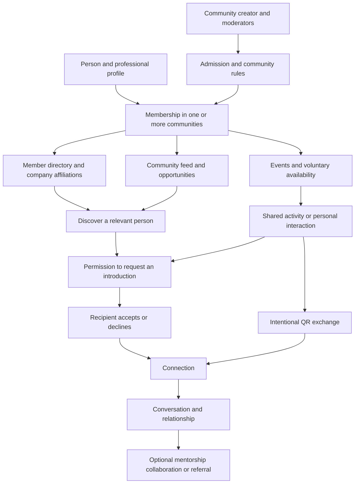
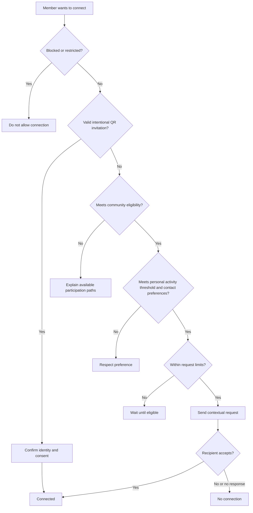

# CommunityConnect Concept and Development Plan

CommunityConnect is a working name for a professional network organized around shared communities. Members discover one another’s professional affiliations, participate in community life, and build relationships that may eventually lead to mentorship, collaboration, or referrals.

The central product hypothesis is that shared community participation can make professional introductions more meaningful and less intrusive. This is a concept to validate, not yet an established business opportunity.

**Status:** Initial concept and proposed plan, November 1, 2026. Original ideas and proposed changes are distinguished below. No implementation, market research, or outreach has begun.

# Working together

You lead the project and build as much of it yourself as you want. My role is to help you understand choices, plan, research assigned questions, review your work, debug, and build only the parts you delegate. Broader implementation happens only when you ask for it.

For each future task, we can choose a mode: explain, guide you through it, review your attempt, or implement an assigned piece. Planning should produce small learning milestones with a clear definition of done.

# The original concept

The community is the primary organizing unit. Examples to explore include alumni groups, campus organizations, coworking communities, and professional associations. Companies appear as member affiliations rather than being the main organizing structure.

- People can create communities and manage admission and community rules.

- Members can browse fellow members and their company affiliations. Professional role or seniority may also be visible.

- Members choose which community receives a post. Feeds can eventually support text, images, links, files, video, and opportunities.

- Communities set an activity baseline for membership. Members can see one another’s activity and set personal activity thresholds for interaction and connection requests, including a configurable number of qualifying visits or activities during a defined period.

- Location permission could be one method of establishing physical attendance.

- A separate proposed rule would allow requests down a professional hierarchy while restricting requests upward.

- People who meet can exchange a QR code to connect directly.

- Members may share planned visits, availability, or visit frequency to help others meet them.

- Referrals should arise from genuine human relationships rather than mass requests to people at desirable companies.

**Clarified activity model:** Members can see how active other community members are. Each community sets an activity baseline for membership, and each member can set a personal activity threshold for the people they are willing to interact or connect with. The membership baseline applies to all members; a recipient’s personal threshold applies to the person seeking interaction. Activity therefore supports both membership eligibility and connection decisions. What counts as activity, the measurement period, and the consequences of falling below the baseline remain to be defined.

# Concept map

This map shows the proposed relationship flow. Participation creates opportunities to meet; a connection does not create an obligation to help or refer someone.

# Assessment of the request system

My initial product judgment is that the strongest idea is discovery within an existing community, paired with clear consent and opportunities to interact. The weakest part is making job rank the main permission system. Whether people want this product remains a research question.

| Mechanism | Intended benefit | Design concern | Proposed direction |
| --- | --- | --- | --- |
| Shared community directory | Find relevant people nearby in social context | A shared membership alone does not establish trust | Keep discovery separate from messaging permission |
| Participation requirement | Discourage drive-by requests | Attendance can be gamed and excludes some genuine participants | Test several participation paths and explain eligibility clearly |
| Location-based attendance | Establish visits | Presence does not establish a relationship; tracking adds privacy and operational complexity | Defer GPS and test voluntary event check-ins first |
| Requests based on seniority | Protect people from unwanted demands | Titles are ambiguous; students may be welcome contacts; senior people can also spam | Use recipient preferences and request limits instead |
| QR connections | Make an in-person introduction easy | Codes can be forwarded or copied | Use intentional, short-lived exchange with explicit consent |
| Visit schedules | Make meetings easier | Personal routines can enable unwanted approaches | Start with opt-in events or office hours |
| Greater access through activity | Reward engagement | Can turn community participation into a competition for access | Improve eligibility to ask, never entitlement to someone’s attention |

A top-down system would also need a credible way to compare founders, students, contractors, researchers, executives, and people between jobs. It could block useful relationships without reliably blocking bad behavior. I would not make it the default.

“Better people” is better expressed in the product as “relevant people” or “people open to connecting.” Seniority can help someone understand a role, but should not determine a person’s value or whether their boundaries count.

# Proposed connection rules

Treat these as a discussion draft.

1. **Discovery:** Approved members can browse the community directory and see fellow members’ activity. The proposed display is a participation summary, such as qualifying activities within a stated period or baseline status, rather than precise location history. Choose what professional information membership requires, what is optional, and what remains hidden outside the community.

2. **Membership baseline:** The community sets a minimum activity requirement for membership. Define qualifying activities and the measurement period, with an accessible alternative to physical attendance. **Open decision:** Falling below the baseline could end membership or lead to inactive status with limited privileges. A grace period followed by inactive status is a proposal, not a settled rule.

3. **Personal interaction threshold:** Each member can set the minimum activity level others must meet to interact or request a connection with them, in addition to the community membership baseline. Members can use visible activity to inform connection decisions. Proposed additional preferences include whether to receive requests, which topics they welcome, and whether introductions or shared events are required. Meeting a threshold permits a request; acceptance remains voluntary. Which interactions the threshold governs remains to be defined.

4. **Limits:** Apply small, configurable request allowances, cooldowns, and limits on pending requests. Exact thresholds should follow pilot evidence.

5. **Context:** A request includes a short reason and relevant shared context. A job title alone does not establish eligibility.

6. **Consent:** Accepting, declining, or ignoring remains the recipient’s choice. Declines must not enable repeated pressure through another shared community.

7. **Direct exchange:** A recipient intentionally generates a short-lived QR invitation. The scanner sees who they are connecting to and confirms. The invitation expresses the issuer’s consent; blocks and safety restrictions still apply.

8. **After connecting:** Both people retain block, report, and disconnect controls. A connection does not automatically grant permission to send referral requests.

Community participation is evidence of participation, not proof of trustworthiness. Do not present check-ins, post counts, or QR exchanges as proof of a genuine relationship.

# Attendance and meeting design

For an early pilot, consider organizer-confirmed event attendance or a rotating event check-in code. Neither completely prevents false attendance, but both let us test whether participation rules are useful before building location infrastructure.

If physical visits later become important, define what counts as a visit, the time window, duplicate handling, verification failures, retention, and an alternative for members unable to attend. Distinguish attendance verification from publishing attendance.

Availability should initially describe a deliberate invitation such as “open to meeting at Thursday’s community event.” Avoid default display of live presence, personal routines, or individual visit history. Even an aggregate visit frequency should be voluntary.

A person who opts out of sharing availability should still be able to participate in the community. Whether the initial pilot includes minors is a decision to settle before recruitment.

# Product surfaces and information model

| Surface | Purpose |
| --- | --- |
| My communities | Switch between memberships and discover permitted communities |
| Community home | Show purpose, rules, upcoming activities, and community feed |
| Member directory | Find people by relevant company, role, interest, and willingness to help |
| Member profile | Show permitted affiliation details, shared context, and contact preferences |
| Requests and connections | Review contextual requests and manage existing relationships |
| Events and availability | Join shared activities and offer voluntary meeting opportunities |
| Community administration | Manage admission, rules, moderation, and reports |

The initial information model would contain people, professional affiliations, communities, memberships, posts, events, participation records, connection requests, connections, contact preferences, and reports. A person can belong to multiple communities, and an affiliation may be self-reported or verified. Those statuses should not be confused.

**Open design decision:** Should a connection persist when one person leaves the shared community? A reasonable starting proposal is to preserve mutually accepted connections while removing access to that community’s directory and private content.

# Proposed first test and MVP boundary

First test the central behavior with one existing community and a willing organizer: do members want contextual introductions, and do experienced members find them welcome?

A small, manually facilitated pilot can use a consented directory, a shared event, and opt-in introductions. Do not assume a full social feed is necessary to test the idea.

If that test supports building, a proposed minimum viable product is:

- Accounts, profiles, and clearly labeled professional affiliations.

- Community creation, admission, membership, and basic administration.

- A community-only directory with company and role discovery.

- Visible activity summaries, community membership baselines, personal interaction thresholds, contextual requests, acceptance, and request limits.

- An intentional QR connection flow.

- A simple community feed with text and links.

- Blocking, reporting, moderation, and basic account/data controls.

Consider basic event participation if interviews show it is essential to the connection rules. Defer continuous location, rank-based access, public visit histories, algorithmic feeds, video hosting, complex file uploads, referral marketplaces, and calendar integrations. The broader multimedia feed remains part of the long-term concept.

The smallest useful journey is: join a community, find a relevant person, establish context, request or exchange a connection, and choose to continue the conversation.

# Validation and business questions

The first research phase should examine behavior, not just whether people say the idea sounds good.

| Audience | Questions to investigate |
| --- | --- |
| Students and early-career members | Describe the last time you sought advice or a referral. How did you find someone, and where did the process fail? |
| Experienced members | Which requests do you welcome? What makes you ignore a request? Would an event or introduction change that? |
| Community organizers | How do members currently find each other? Who handles unwanted contact? What would make administering another tool worthwhile? |

Research should compare the proposed workflow with the tools a target community already uses, including professional networks, group chat, member directories, and events. Do not assume competitors lack these capabilities before examining them.

The business has at least two customers to understand: the member who needs value and the organizer who might distribute or pay for the product. A possible model is organizer-paid community software, but willingness to pay is untested. Charging for access to senior people could undermine the relationship-first premise.

Marketing should start with a specific community and a clear promise, such as helping members turn shared participation into useful professional relationships. Potential pilot channels include an organizer’s existing newsletter, onboarding process, and events. These are proposed experiments, not outreach authorization.

Estimate costs only after scope is chosen: hosting, authentication, storage, media delivery, verification, moderation, support, and payment processing where relevant. Pricing, market size, differentiation, and legal requirements need dedicated research.

Possible pilot measures include welcomed introductions, repeat participation by both early-career and experienced members, recipient-reported request quality, complaints, organizer workload, and willingness to continue or pay. Choose success and stop criteria before the pilot. Referral counts alone would miss whether the community is becoming useful.

# Learning and SDLC plan

SDLC means software development life cycle: understand the problem, define requirements, design, build, test, release, and improve. Each phase should produce something you can explain yourself.

| Phase | Your learning focus | Concrete output | Gate before moving on |
| --- | --- | --- | --- |
| Problem discovery | Interviewing and separating assumptions from evidence | Target community, problem statement, interview findings | Evidence of a recurring problem on both sides |
| Product definition | User stories and acceptance criteria | MVP boundary and connection-rule decision table | Rules understandable to members and organizers |
| Experience design | Journeys, wireframes, usability testing | Clickable or paper prototype of the core journey | People can complete and understand it |
| Technical design | Data modeling, authentication, authorization, system tradeoffs | Small architecture and data model | Membership and consent boundaries are explicit |
| Incremental build | Implementing complete user journeys | Small working slices you build and can explain | Each slice meets its acceptance criteria |
| Verification | Functional, permission, abuse, and usability testing | Test results and fixed critical issues | Private data and request rules hold under misuse |
| Pilot release | Deployment, monitoring, support, rollback | Limited community release with an accountable organizer | Support and moderation are ready |
| Iteration and business review | Product metrics, retention, cost, pricing | Continue, revise, or stop decision | Evidence justifies the next investment |

Useful future acceptance tests include: a nonmember cannot read the private directory; a blocked person cannot reconnect via QR; ineligible users receive an explanation; location refusal has an alternate participation path; leaving a community removes its private access; and repeated requests cannot bypass limits by switching communities.

Choose a technology stack after your current skills, learning goals, platform needs, and MVP are clear. No stack or delivery dates are committed here.

# Next steps when you are ready

1. **Review the concept:** Mark what accurately captures your intent and which proposed alternatives you disagree with.

2. **Choose the first community:** Identify a real group you can reach, its organizer, and whether it is primarily physical, online, or hybrid.

3. **Define activity rules:** Choose qualifying activities, measurement periods, visible activity summaries, and how personal interaction thresholds work alongside the community membership baseline. Decide whether falling below the baseline causes removal or inactive status, whether a grace period applies, and how new members first meet the baseline.

4. **Assign a focused research task:** Investigate existing alternatives and interview a small set of members, experienced professionals, and organizers. We can prepare the research plan before anyone is contacted.

5. **Choose a test:** Define the smallest experiment that could disprove the core assumption, with success and stop criteria.

6. **Draft requirements and sketches:** Write the core user stories and draw the few screens required for the first journey.

7. **Plan your first learning milestone:** Select a small piece you want to build yourself and agree on how much guidance you want.

**First decision for our next planning conversation:** Which real community would you want to serve first, and what access do you already have to its members or organizer?

The highest-risk assumption is that shared participation will make people more willing to connect without making the experience feel monitored or transactional. Test that before investing in a large feed or elaborate access rules.

